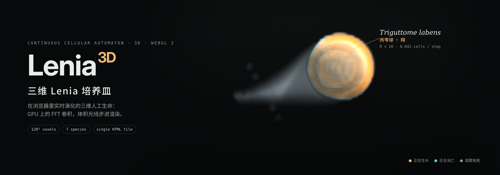

# 三维 Lenia 培养皿 · Lenia 3D Petri Dish

在浏览器里实时运行的三维 [Lenia](https://chakazul.github.io/lenia.html) 连续元胞自动机。整个模拟用 WebGL 2 在 GPU 上完成：三维 FFT 卷积、生长更新、逐体素光照，最后用体积光线步进渲染。

A real-time 3D Lenia (continuous cellular automaton) running entirely on the GPU in the browser: 3D FFT convolution, growth update, per-voxel lighting, and volumetric ray marching — one self-contained HTML file, no build step.

## 运行

直接用最新版 Chrome、Edge 或 Safari 打开 `index.html`。需要支持 WebGL 2 和浮点渲染目标（`EXT_color_buffer_float`）的显卡。

## 里面有什么

- **7 种三维物种**，数据来自 Bert Chan 的 Lenia 项目：会滑行的丙雫球（*Triguttome labens*）、会跳的乙雫球（*Diguttome saliens*）、整张飞行的平膜（*Planomembranome saliens*）、原地转动的六面球、四面球、八面球，以及最简单的正球。
- **五种世界**：宽敞（128³，生物原尺寸，一次放入多只、朝向随机）、精细（128³，生物放大 2 倍）、流畅（64³），以及给高端显卡的 256³（放大 2 倍，约 1GB 显存）和 512³（放大 4 倍，约 8GB 显存）。显存不够时自动退回 128³。
- **世界首尾相连**：生物从一面出去会从对面进来；“跟随”默认开启，会把一只生物一直保持在画面中央。会飞的平膜在更大的世界里会沿它的周期方向铺满，不会因为出现边缘而散掉。
- **烟雾拖尾**：沉积量按到运动轴的距离加权、随时间指数衰减，宽度按 r = r₀·e^(−t/τ) 从粗到细收窄；τ 按生物速度自适应。
- **方向矢量**：每 0.5 秒统计一次每只生物的质心并跨帧匹配，画出速度箭头。
- 可调：μ、σ、光照强度、不透明度、剖切面、每帧模拟步数。

## 实现要点

| 环节 | 做法 |
|---|---|
| 存储 | 三维网格按 z 切片平铺成一张二维纹理（64³ → 512×512，128³ → 2048×1024，256³ → 4096×4096，512³ → 16384×8192），按显卡的纹理上限自动选择排布 |
| 卷积 | 每轴 log₂N 次 radix-2 Stockham FFT，正变换 → 乘核频谱 → 逆变换，每步固定 38–44 个全屏 pass |
| 核 | Lenia 原版多层球壳核 `K(r) = b[⌊kD⌋]·exp(4 − 1/(f(1−f)))`，直接在 GPU 上生成后做 FFT，频谱只在换物种时算一次 |
| 光照 | 每个体素朝光源步进 12 次累积透射率，每两帧刷新一次 |
| 渲染 | 指数吸收的发射–吸收模型；琥珀色 = 正在生长，青色 = 正在消亡 |
| 统计 | 2×2×2 块求和降采样到 64³ 再读回，避免整块回读拖慢 GPU |

## 验证

- FFT 公式与 numpy 对照，误差 ~10⁻¹³。
- 同一物种在 GPU 与 CPU（numpy FFT）上逐步对比质量：丙雫球 64³ 第 100 步 512 / 512，128³ 第 100 步 4067 / 4059；六面球、平膜的误差在 0.1% 以内。
- 二维对照实验：用同一套更新规则复现了 Orbium 的滑行（速度约 0.62 格/步）；把核换成长尾的高斯差后 Orbium 立即死亡，截断尾巴后又恢复滑行，说明核的紧凑支撑是生物能否移动的关键。

## 致谢与许可

- 本项目代码以 MIT 许可发布，见 [`LICENSE`](LICENSE)。

- 物种数据（`index.html` 中的 `SPECIES`）来自 [Chakazul/Lenia](https://github.com/Chakazul/Lenia)，© 2018 Bert Chan，MIT 许可，原文见 [`THIRD_PARTY_LICENSE_Lenia.md`](THIRD_PARTY_LICENSE_Lenia.md)。
- 参考：Bert Wang-Chak Chan, *Lenia — Biology of Artificial Life* (2019); *Lenia and Expanded Universe* (2020).
